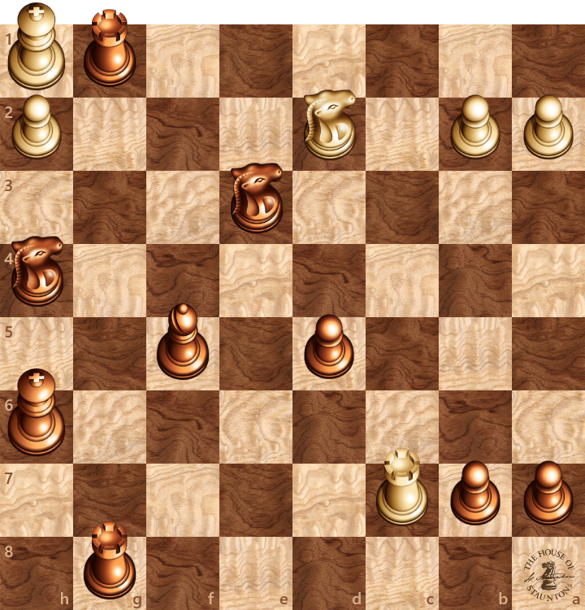

  

## `> whoami`

Curious mind. Terminal open. Limits questioned. 
Building apps · Designing visuals · Hacking knowledge · Shipping progress.

 

---

### 🛠 Stack

<table>
<tr>
<td align="center" valign="top" width="50%">

**Languages & Frameworks**

&nbsp;
&nbsp;
&nbsp;
&nbsp;

 

&nbsp;
&nbsp;
&nbsp;
&nbsp;

  

**+ New :**&nbsp;
&nbsp;
&nbsp;
&nbsp;

</td>
<td align="center" valign="top" width="50%">

**Environment & Tools**

&nbsp;
&nbsp;
&nbsp;
&nbsp;

</td>
</tr>
</table>

 

---

### 🔐 Security

<table>
<tr>
<td align="center">

**HackTheBox**

</td>
<td align="center">

**TryHackMe**

</td>
<td align="center">

**CTF Team**

`D6ath E9ters` — active CTF competitor 
NCSC · CS4TN · and more

</td>
</tr>
</table>

 

---

### 📦 Featured Project

**[SmartBookHub](https://github.com/duzcoder)** — AI-powered book e-commerce platform 
`React` · `Vite` · `Laravel` · `Python` · `AI/ML` · *PFE @ Al Ryeda Consulting*

 

---

### 📰 Writing on Medium

 

 

 

---

### ♟ Checkmate

&nbsp;&nbsp;
&nbsp;&nbsp;

  

